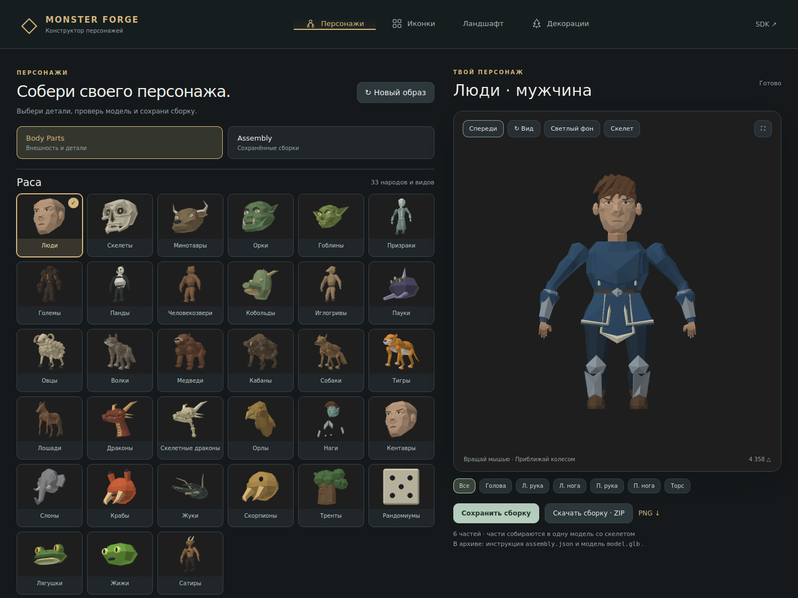
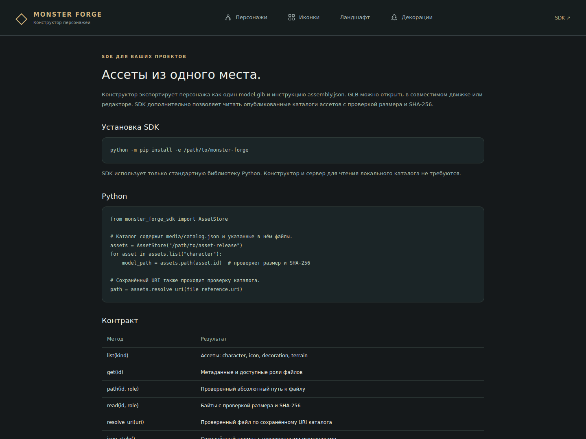

# Monster Forge

Monster Forge is a standalone modular low-poly character constructor. Its
existing race catalog, faces, hair, clothing, body shapes, accessories and
material controls are part of the product. `Body Parts` and `Assembly` share
one preview, with saved settings and immutable character revisions.

Characters export as `assembly.json` and one `model.glb`. Humanoid exports
contain their skeleton and skin weights. Existing authoring templates without
a rig export static geometry. Games and other tools can consume these files
or use the dependency-free asset SDK.

The constructor, its built-in recipes, race definitions, presets and required
source references are included under **Apache-2.0**. Unrelated game assets,
imported applications and private Git history are excluded.
See [LICENSE](LICENSE), [NOTICE](NOTICE),
[the exact license scope](LICENSE_SCOPE.md), and [release instructions](docs/releasing.md).

## Run the character constructor

Requires Python 3.12+ and [uv](https://docs.astral.sh/uv/). The existing constructor
source pack is included. The first launch installs the locked Python dependencies.

```sh
make run
```

Open <http://127.0.0.1:5050/characters/>. Choose a race and appearance, mix the
existing parts, adjust materials, then save or download the assembled character.
The constructor keeps the established settings schema and source catalog.

Without uv:

```sh
python3.12 -m venv .venv
.venv/bin/python -m pip install -e '.[app]'
make run
```

Application modes are `auto`, `library`, and `authoring`; capabilities are
explicit at `GET /api/capabilities`. The optional asset browser can also run
with its mathematical examples using `make demo`, without a character source
pack. That command exercises the library and viewer rather than the full race
and part catalog.

## Screenshots

Real browser captures from the standalone constructor and built-in SDK guide.

| Character constructor | Built-in SDK guide |
| --- | --- |
|  |  |

## Use the SDK

Python 3.11+, standard library only. The wheel contains `monster_forge_sdk`;
the browser application runs from this source checkout. The `app` extra installs
the source application's dependencies.

```sh
python -m pip install -e .
```

```python
from monster_forge_sdk import AssetStore

assets = AssetStore("/path/to/release")  # contains media/catalog.json
for asset in assets.list("decoration"):
    model_path = assets.path(asset.id)  # verifies size and SHA-256
```

The SDK does not import Flask, the authoring tools, or the animation solver.

## Export to other applications

Composition, preview, skin weights and export run independently. Import the
exported GLB into a compatible engine or modelling tool. The humanoid extension
contract is `humanoid_v1`; existing additional race templates remain available.
Tripo remains a manual equipment workflow; Equipment and Playground remain
documented roadmap work.

## Extend the project

- [Contributing and supported extension points](CONTRIBUTING.md)
- [Architecture and ownership](docs/architecture.md)
- [Development and tests](docs/development.md)
- [Versioned constructor presets](docs/constructor-presets.md)
- [Tools-only export and release checks](docs/releasing.md)
- [Product boundaries and remaining workflows](docs/roadmap.md)
- [Production rules](AGENTS.md)

The art direction comes from `config/style_profile.json`. New source bundles
must use the approved Front positioning template and the existing skeleton,
retain their provenance, and receive immutable revisions.

## Check a change

```sh
make check      # supported core lint, frontend formatting/tests, portable tests
make test-sdk   # Python -S: SDK without third-party packages
make test       # constructor and SDK tests using the included source pack
make build     # SDK wheel and sdist
```

Development checks additionally require Node.js 22+; `make setup` installs
the development dependencies and pinned formatter.

CI runs the portable checks without a game checkout. Integration validation
checks geometry, bind poses, slot bone limits, hashes and settings preservation;
passing tests does not establish artistic quality.
