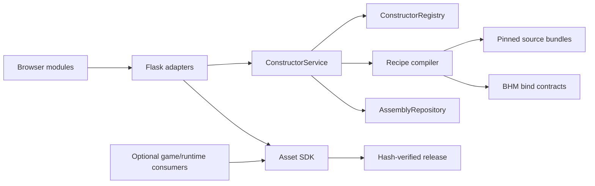

# Architecture

Monster Forge is a standalone modular character constructor. It preserves the
existing race, part and appearance catalog, with immutable sources and versioned
settings. New production extensions target `humanoid_v1`; established source
contracts remain explicit data. Games and other applications consume
the exported files or the SDK.

## Dependency direction

The SDK never imports the application, compiler or game. The core constructor API
can be imported without the game and without loading the historical inventory.
Static character composition and export use project-owned bind data. Optional
runtime animation remains an external integration, with no FK/IK solver in the
browser.

## Ownership and extension boundaries

| Component | Owner and public surface |
| --- | --- |
| `monster_forge_sdk/` | Release reads, hash verification, consumer cache, BHM bind contracts and portable GLB/skin readers. Standard library only. |
| `monsterforge/constructor/registry.py` | Explicit immutable source registrations, supported contracts and isolated inventories. `with_source()` returns a new registry. |
| `constructor/settings.py` | Settings validation and version migrations against the selected registry. |
| `constructor/sources.py` | Source containment, recipe/model equivalence and provenance verification. |
| `constructor/geometry.py`, `builder.py` | Recipe composition and compilation using explicit registry, source-loader and renderer ports. |
| `constructor/catalog.py` | Projection of the installed race, part, attribute and preset inventory with explicit source contracts. |
| `constructor/service.py` | One registry/repository through validation, preview, export and save. |
| `workshop_constructor.py` | Compatibility facade for old imports and publishing-command overrides. New integrations use the constructor package. |
| `assembly_repository.py` | Atomic immutable persistence, schema admission, verified download snapshots and historical local assemblies. No geometry compilation. |
| `character_assembly.py` | One baked GLB and display of that exact artifact. |
| `serialization.py` | Canonical JSON bytes shared by revisions and publication. Byte changes change revision IDs. |
| `constructor_cache.py`, `paths.py` | Rebuildable products and isolated work directories in `/tmp/monster-forge`. |
| `web.py`, `asset_library.py`, `creature_workshop.py` | App configuration, capability reporting and HTTP adapters. |
| `runtime.py` | Source-pack availability and optional runtime integration capabilities. |
| `tools/` | Import and publication commands; historical authoring compatibility code. |
| `static/characters/` | Native modules for state, API, selection, options, palettes, preview, revisions, picker and app composition. |
| `static/library/` | Library factory using the same explicit dependency approach. |
| `constructor-viewer.js` | Rendering of supplied geometry; no game or animation solver. |

Source registrations describe reviewed humanoid data. They do not add arbitrary
executable plugins, new creature rigs or a universal autorig. Use
`ConstructorService` in tools and optional `CONSTRUCTOR_SERVICE` app configuration
for an explicit application integration. HTTP, validation and build must use the
same registry.

## Data lifecycle

| Data | Location and mutation rule |
| --- | --- |
| Asset release | `media/catalog.json` with pinned files; published bytes are immutable. |
| Source evidence | Images, composite GLBs, recipes, assignments, prompts, references and source history. Preserve them across derived rebuilds. |
| Shipped presets | `config/constructor_presets/v1/`; complete settings plus versioned index. Edits require a new publication to change finished output. |
| Constructor artifact index | `config/constructor_artifacts_v1.json`; versioned recipes, never a fallback for unknown schemas. |
| Local assemblies | `data/character_constructor/<id>/`; instruction schema 2 and one GLB. Humanoids are skinned; authoring templates without a rig remain explicit static drafts. |
| Published assemblies | `media/assemblies/`; immutable instruction and model revisions. |
| Consumer cache | Optional SDK content cache; pinned releases survive catalog updates. |
| Compiler/review work | `/tmp/monster-forge/<checkout-hash>/`; discard and reconstruct it. |
| Historical reviews | Existing `artifacts/`; preserve evidence during migration, create no new working files there. |

Settings, catalog and assembly schemas are separate contracts. A new assembly
export contains exactly `assembly.json` version 2 and `model.glb`. Version 1
directories remain readable through the repository. Unsupported versions and
corruption are visible errors. Export validates the exact bytes it packages.

## Product and presentation

The editor exposes `Body Parts` and `Assembly` with a shared viewer and preserved
selection. Its installed races, gender choices, faces, hair, body shapes,
clothing, independent limbs, accessories, material colors and numbered
attributes remain part of the same product. Published versions can be viewed
and downloaded without rebuilding them; editing preserves the source settings
and their explicit compatibility checks.

Equipment and Playground remain incomplete workflows. Do not create empty tabs,
add an automatic Tripo service, or implement a second game runtime to make the
navigation look complete. Their contract is defined in [AGENTS.md](../AGENTS.md).

The low-poly art direction has one source: `config/style_profile.json`. The UI
uses common tokens and system typography in `static/project.css`; other styles
are scoped to their workspace. Frontend modules receive state and collaborators
explicitly; entrypoints compose them without a bundler.

## Public development and release scope

`make run` opens the full constructor with its included races, parts and presets.
`make demo` exercises the auxiliary asset library with mathematical examples.
The constructor runs without a game checkout or external animation package.

The Apache-2.0 source includes software, documentation, SDK bind contracts and
the exact built-in resources listed in `config/constructor_resources_v1.json`.
This inventory pins recipes, settings, source records and required original
reference images. GLBs, weights and UI cards are reconstructed outside Git.
The SDK wheel packages only SDK code and its three bind-contract resources.

Unrelated game art, imported applications, private state and historical Git
objects stay outside the public source snapshot. Source evidence retained
locally is not deleted by release preparation.

[LICENSE_SCOPE.md](../LICENSE_SCOPE.md) defines the boundary alongside
[LICENSE](../LICENSE) and [NOTICE](../NOTICE). Release checks and exports prepare
local files; they do not publish anything or change Git history.

See [development](development.md), [contributing](../CONTRIBUTING.md), and
[release preparation](releasing.md).
